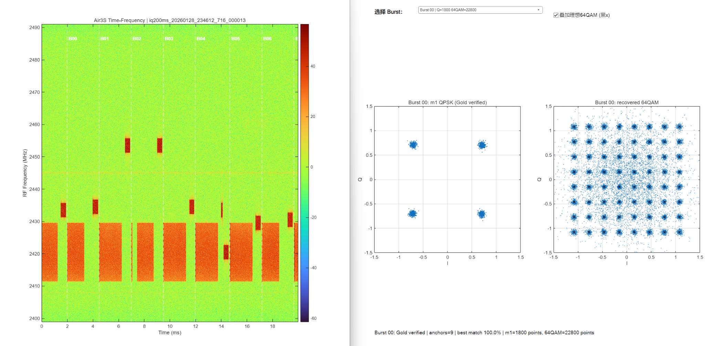
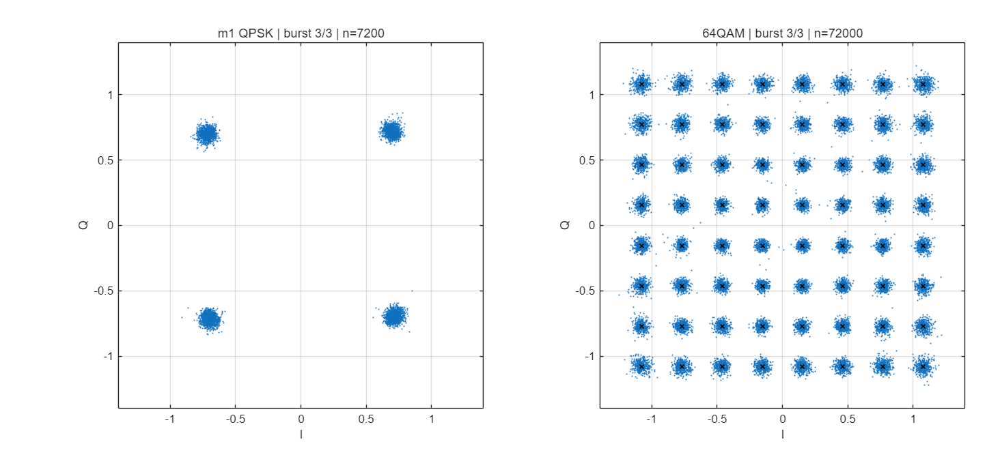
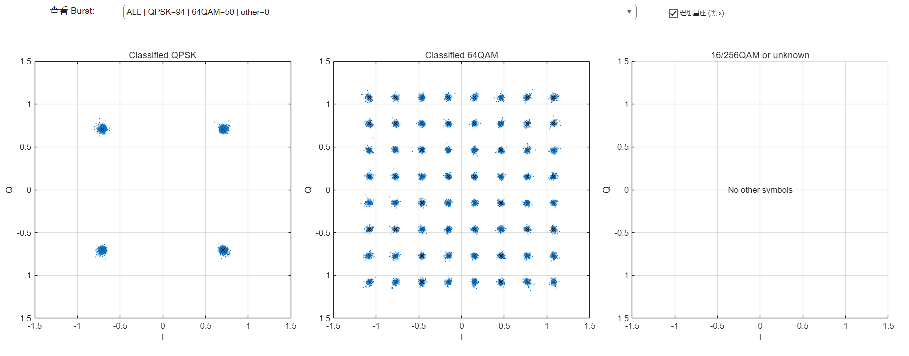

# DJI OcuSync Protocol Research

### Physical-Layer Analysis and Signal Decoding of O3, O4, and O4+

> **Independent research · Work in progress · Unofficial project**
>
> This repository studies **DJI's OcuSync video transmission protocols**, with a focus on RF waveform analysis, OFDM synchronization, channel estimation, and constellation recovery. The current experiments cover **DJI Air 2S (O3), DJI Air 3S (O4), and DJI Mini 5 Pro (O4+)**.

**This project concerns DJI OcuSync video transmission signals, not DJI DroneID or Remote ID broadcasts.** It is not affiliated with, sponsored by, or endorsed by DJI.

Researchers interested in OcuSync signal processing, software-defined radio (SDR), and collaborative physical-layer analysis are welcome to get in touch: **[1048181961@qq.com](mailto:1048181961@qq.com)**.

## Research Overview

Our work starts from recorded complex IQ samples and uses conventional digital signal processing rather than machine-learning-based classification. The principal receiver stages are:

```text
Recorded SDR IQ samples
          |
          v
RF channel search, digital downconversion, resampling
          |
          v
Zadoff-Chu (ZC) reference generation and matched filtering
          |
          v
Burst detection, OFDM timing, CP analysis, CFO correction
          |
          v
Reference/pilot-assisted channel estimation and equalization
          |
          v
QPSK / QAM symbol recovery and constellation visualization
```

### Common Physical-Layer Characteristics

The studied OcuSync recordings exhibit **LTE-like OFDM characteristics**, including organized subcarriers, cyclic prefixes (CP), Zadoff-Chu reference sequences, and QPSK/QAM constellations. This description indicates similarities to techniques used in LTE; **it does not mean that OcuSync fully implements or conforms to the 3GPP LTE specification**.

A shared feature across the three studied signal types is the use of **ZC-based reference structures for correlation / matched-filter synchronization**. The ZC sequence *length* is not necessarily the same as the ZC *root*. Different signal configurations may use different roots, even when their sequence lengths are identical.

The ZC lengths considered in our broader research are **293, 601, 1201, and 2399**:

| ZC sequence length | Relevance to this repository |
| ---: | --- |
| 293 | Investigated as a candidate length; not implemented in the three included receivers. |
| 601 | Used by the Air 3S receiver; the Air 2S receiver uses two interleaved comb branches derived from length-601 ZC sequences. |
| 1201 | Used by the Mini 5 Pro receiver. |
| 2399 | Investigated as a candidate length; not implemented in the three included receivers. |

The presence of a particular ZC length alone is **not sufficient for model identification**. The sequence structure, root, OFDM parameters, and other reproducible physical-layer features must be considered together.

## PHY Parameters of the Studied Models

The following table summarizes the **working configurations in the MATLAB receiver scripts and the associated experiments**. These are research observations and implementation parameters, **not an official DJI protocol specification**.

| Parameter | DJI Air 2S (O3) | DJI Air 3S (O4) | DJI Mini 5 Pro (O4+) |
| :--- | :--- | :--- | :--- |
| Receiver sample rate | 30.72 MS/s | 30.72 MS/s | 30.72 MS/s |
| FFT size | 2048 | 1024 | 2048 |
| Subcarrier spacing | 15 kHz | 30 kHz | 15 kHz |
| Active subcarrier indices | -600 to +600 | -300 to +300 | -600 to +600 |
| Active frequency bins | 1201 (including DC) | 601 (including DC) | 1201 (including DC) |
| ZC reference structure | Dual-comb, even/odd branches | Single 601-length ZC reference | 1201-length ZC, multiple reference positions |
| ZC sequence length | 601 per branch | 601 | 1201 |
| ZC root in current receiver | Estimated separately for the two branches | 330 | 232 |
| CP lengths (samples) | 144 / 160 | 72 / 88 | 144 / 160 |
| Recovered modulation constellations | QPSK, 64QAM | QPSK, 64QAM | QPSK, 64QAM |
| Main recovery approach | Dual-comb channel estimation; adjacent-subcarrier SFBC/Alamouti-form decoding | Gold-pilot-assisted channel estimation; decision-directed refinement | Multiple ZC references; time-interpolated channel estimation; modulation classification |

**Notes:** The receiver sample rate is the rate used for baseband processing, not necessarily the SDR's original capture rate. Air 2S roots are estimated from the recording; they are not assumed to be universal constants. Observing a recognizable constellation does not, by itself, establish error-free bit recovery or full protocol decoding.

## Dataset and Usage

### Capture Environment

The example IQ recordings provided in this repository were **captured in a microwave anechoic chamber** under controlled experimental conditions. The chamber reduces reflections and external RF interference, so the captured waveforms are **relatively clean** and are well suited to studying OcuSync physical-layer structures, such as ZC references, OFDM synchronization, and QPSK/64QAM constellation recovery.

**Important:** These results represent controlled laboratory captures. They should not be treated as a benchmark for outdoor reception, multipath fading, crowded spectrum conditions, or long-range performance. No precise SNR or interference figure is claimed here.

### Dataset Layout

The repository contains a **small selection of example recordings**, not the complete experimental dataset:

```text
O3/
  Air2s_data/
    air2s_one/              # Air 2S example MAT recordings
    air2s_two/              # Optional second recording group, if included
  Air2s_decode/
    Air2S_decode.m
O4/
  air3s_data/               # Air 3S example MAT recordings
  air3s_decode/
    Air3S_decode.m
O4+/
  mini5pro_data/            # Mini 5 Pro example MAT recordings
  mini5pro_decode/
    Mini5Pro_decode.m
images/                     # Figures shown below
README.md
```

The exact number of available `.mat` files can change as the public example set is curated. Refer to the folders in the current repository rather than assuming that every filename shown in earlier experiments is available.

### IQ File Format

The sample recordings are MATLAB `.mat` files and typically store the received baseband IQ and acquisition metadata in a structure named `seg`:

| MAT field | Meaning |
| :--- | :--- |
| `seg.iq` | Captured complex IQ samples (some files may use a two-column I/Q array). |
| `seg.fs` | **Original SDR acquisition sample rate**, in samples per second. |
| `seg.fc` | RF center frequency, in Hz. |

The receiver scripts downconvert and/or resample the captured data to their **30.72 MS/s working rate**. Do not confuse this processing rate with the sample rate stored in `seg.fs`. Also, determine the capture duration from `numel(iq)/fs`, not the `iq200ms` filename prefix: some supplied recordings contain about **20 ms** of samples even though their filenames contain `200ms`.

### Quick Start in MATLAB

1. Clone or download the repository, and open MATLAB in the repository root directory.
2. Choose a model and an example `.mat` file in its corresponding data folder.
3. In the matching receiver script, update `inputPath` (**Air 2S / Mini 5 Pro**) or `matFile` (**Air 3S**) to the selected file's full path.
4. Run the script. Inspect the logged ZC/reference detection, CFO and EVM results, and the recovered QPSK/64QAM constellations. Some scripts also support additional output files; consult their configuration sections.

For example, to inspect the first available Air 2S sample (from the repository root):

```matlab
files = dir(fullfile('O3', 'Air2s_data', 'air2s_one', '*.mat'));
assert(~isempty(files), 'No Air 2S sample MAT files were found.');
matPath = fullfile(files(1).folder, files(1).name);
s = load(matPath, 'seg');

x = s.seg.iq;
if isreal(x) && ismatrix(x) && size(x, 2) == 2
    x = double(x(:, 1)) + 1j * double(x(:, 2));
else
    x = double(x(:));
end

Fs = double(s.seg.fs(1));
Fc = double(s.seg.fc(1));
fprintf('Samples: %d | Fs: %.2f MS/s | Fc: %.3f GHz | Duration: %.2f ms\n', ...
    numel(x), Fs / 1e6, Fc / 1e9, 1e3 * numel(x) / Fs);
```

**Note:** These IQ examples are intended for reproducible *signal-processing research and visualization*, not as evidence of a fully decoded DJI OcuSync protocol or decrypted video stream.

## Experimental Results

The following figures are **real MATLAB results obtained from captured IQ data**, not synthetic ideal constellations. Blue points are recovered symbols. Black crosses, where present, mark ideal constellation locations.

### Figure 1 — DJI Air 3S (O4)



The left panel shows the received time-frequency representation with detected burst markers. The right panel shows a selected burst's **m1 QPSK** constellation and recovered **64QAM** constellation using Gold-pilot-assisted channel estimation. The displayed Gold-pilot match applies to that experimental sample.

### Figure 2 — DJI Mini 5 Pro (O4+)



The recovered **m1 QPSK** and **64QAM** clusters illustrate the output of a receiver using multiple ZC reference positions and channel interpolation across time.

### Figure 3 — DJI Air 2S (O3)



The example file contains **94 OFDM data symbols classified as QPSK** and **50 classified as 64QAM** (`other = 0`). These are **counts of OFDM symbols**, not counts of constellation points. After excluding the DC subcarrier and applying the implemented SFBC recovery, each data OFDM symbol contributes 1200 modulation points. The displayed results depend on the sample and the receiver's EVM classification threshold.

## MATLAB Receiver Scripts

| Model | Script | Focus |
| :--- | :--- | :--- |
| DJI Air 2S | [`Air2S_decode.m`](O3/Air2s_decode/Air2S_decode.m) | Dual-comb ZC, SFBC recovery, interactive QPSK/64QAM constellation display. |
| DJI Air 3S | [`Air3S_decode.m`](O4/air3s_decode/Air3S_decode.m) | ZC burst detection, Gold anchors, QPSK/64QAM recovery. |
| DJI Mini 5 Pro | [`Mini5Pro_decode.m`](O4+/mini5pro_decode/Mini5Pro_decode.m) | Multi-reference synchronization, channel interpolation, constellation recovery. |

**Requirements:** MATLAB with Signal Processing Toolbox and the additional functions used by the selected script. Adjust the local input path near the beginning of each script before running. Some scripts may use optional reference templates or output files; inspect their configuration sections. The code is an ongoing research prototype and has not been validated with every MATLAB release or RF capture condition.

## Research Scope and Limitations

This is an independent, ongoing investigation of DJI OcuSync **physical-layer signal characteristics**. The repository documents synchronization references, OFDM structure, equalization, modulation recovery, and observed constellation patterns. It does **not** claim a complete reverse engineering of all OcuSync protocol layers, full compatibility with LTE, or demonstrated decryption of video payloads.

All product and protocol names are used for identification only. DJI and OcuSync are trademarks of their respective owners.

## Contact and Collaboration

I welcome technical discussion and **joint research into DJI OcuSync video transmission signals**, especially ZC-based synchronization, OFDM reception, SFBC, QAM demodulation, and SDR experiments.

**Email: [1048181961@qq.com](mailto:1048181961@qq.com)**

---

*DJI OcuSync Physical-Layer Research · Work in Progress*
